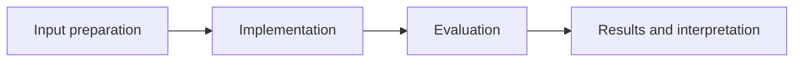

# Parallel Continuous Control with DDPG

**Feras Elghandour** · Technical case study

Control continuous robotic-arm actions while learning from experience shared across parallel simulated agents.

## Implementation

Actor–critic networks, shared replay across 20 agents, Ornstein–Uhlenbeck exploration, deferred gradient updates, critic clipping, and soft target-network updates.



## Evidence and results

The recovered implementation configures a 100-episode rolling score target of 30. The release tests action bounds, replay sampling, gradient updates, and target-network behavior. No numerical training reward is claimed without a recovered reward trace.

Results described as saved come from the retained experiment record. See [VALIDATION.md](VALIDATION.md) for the checks performed on this release and their scope.

## Practical relevance

This project demonstrates actor–critic networks, shared replay across 20 agents, Ornstein–Uhlenbeck exploration, deferred gradient updates, critic clipping, and soft target-network updates.
The implementation and evaluation make the trade-offs inspectable for technical review.

## Run locally

```sh
python -m venv .venv
source .venv/bin/activate
python -m pip install -r requirements.txt
python Continuous_Control.py
# Full simulation also requires a compatible legacy unityagents installation.
```

Prepare the inputs described in [DATA.md](DATA.md) first. Source validation is available without installing model dependencies:

```sh
python scripts/validate_source.py
```

Run the focused offline behavior checks with `python smoke_test.py` after installing the dependencies.

## Limitations

Unity environment binaries and trained weights are not included. Full reproduction requires the legacy Reacher environment and a compatible unityagents runtime; the modern CPU checks exercise the learning core independently.

## Development

Changes should include a clear description of the behavior affected and verification appropriate to that behavior. Keep input data, credentials, model caches, and generated artifacts outside version control.
