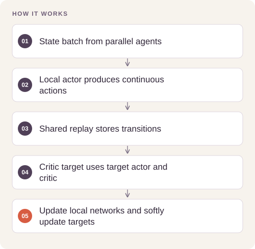

# Parallel Continuous Control with DDPG

Control continuous robotic-arm actions while learning from experience shared across parallel simulated agents.

## Implementation

Actor–critic networks, shared replay across 20 agents, Ornstein–Uhlenbeck exploration, deferred gradient updates, critic clipping, and soft target-network updates.



## Try a small example

Generated transitions exercise actor inference and one replay update. No simulator is launched and no control-policy performance is measured.

After the local setup below, run from the repository root:

```sh
python examples/quickstart.py
```

The [example source](examples/quickstart.py), [captured output](examples/expected-output.txt) and [execution record](examples/environment.json) keep this demonstration inspectable. Floating-point values may vary with library versions.

Observed output from this run:

```text
{
  "fixture": "untrained actor and generated transitions; no rollout",
  "actions": [
    [
      -0.06248923018574715,
      0.07946766167879105
    ],
    [
      -0.06248923018574715,
      0.07946766167879105
    ],
    [
      -0.06248923018574715,
      0.07946766167879105
    ]
  ],
  "replay_size": 8,
  "actor_changed": true
}
```

## Evidence and results

The recovered implementation configures a 100-episode rolling score target of 30. The release tests action bounds, replay sampling, gradient updates, and target-network behavior. No numerical training reward is claimed without a recovered reward trace.

See [VALIDATION.md](VALIDATION.md) for the release checks and their scope.

## Run locally

```sh
python -m venv .venv
source .venv/bin/activate
python -m pip install -r requirements.txt
python Continuous_Control.py
# Full simulation also requires a compatible legacy unityagents installation.
```

Prepare the inputs described in [DATA.md](DATA.md) first. Source validation is available without installing model dependencies:

```sh
python scripts/validate_source.py
```

Run the focused offline behavior checks with `python smoke_test.py` after installing the dependencies.

## Limitations

Unity environment binaries and trained weights are not included. Full reproduction requires the legacy Reacher environment and a compatible unityagents runtime; the modern CPU checks exercise the learning core independently.
